# InfoOS / 信枢

让 AI agent 帮你安装：把 [docs/INSTALL-for-agents.md](docs/INSTALL-for-agents.md) 交给它。

InfoOS 是在用户自有设备上以 Docker 容器形式运行的个人情报系统：采集 → 信息卡 → 外部 agent 分诊、拆解与归并 → 知识卡 → 冻结日报 → 阅读。SQLite 与附件保存在本地；InfoOS 自身不调用 LLM，决策、行动与写作仍属于用户自己的 PKM。

官方支持范围是 RSS、Hacker News、GitHub、Product Hunt 的 registry 声明公开能力，YouTube 公开内容（当前仍需浏览器会话），以及 Web 捕获兜底。Web 不是可配置的定时来源；具体能力以 [registry](backend/domain/sources/registry.py) 为准。

InfoOS 以单容器 Docker Appliance 镜像形式交付；我们在 Linux amd64 上构建与验证，其他平台请使用者自行兼容。首版提供源码与构建脚本，用户自行构建镜像。**需要自备付费外部 agent、账号与额度**，当前提供 Codex CLI 启动器。正式集成接口为提示词模板 + MCP，不保证任意 agent 开箱即用。

最短主链：按下文构建并启动空卷 → 设置自己的管理员和 Token → 添加真实 RSS → 确认信息卡完成 → 外部 agent 经 `/mcp` 写回并回读知识卡 → 冻结 `knowledge_v1` 日报 → 打开阅读链接。

## 功能说明

截图使用最终部署版本运行实例的只读备份副本；订阅名、作者、标题、正文片段、链接与账号已替换为虚构文本，真实统计数字和状态保留。环境与通知合并展示；Token 与账号页展示清除凭据后的创建前状态。复现方法与逐图核验见[截图清单](docs/images/features/README.md)。

### 日报：按用途阅读当天新增知识

日报将知识卡按资讯、商机、项目、选题和沉淀分栏，展示用处、归属与证据强度，并可跳转知识卡和原信息卡。当前 `knowledge_v1` 按北京时间前一日 07:00 至当日 07:00 的窗口冻结，条目带编号；它是经过选条的快照，完整内容可到知识库查看。

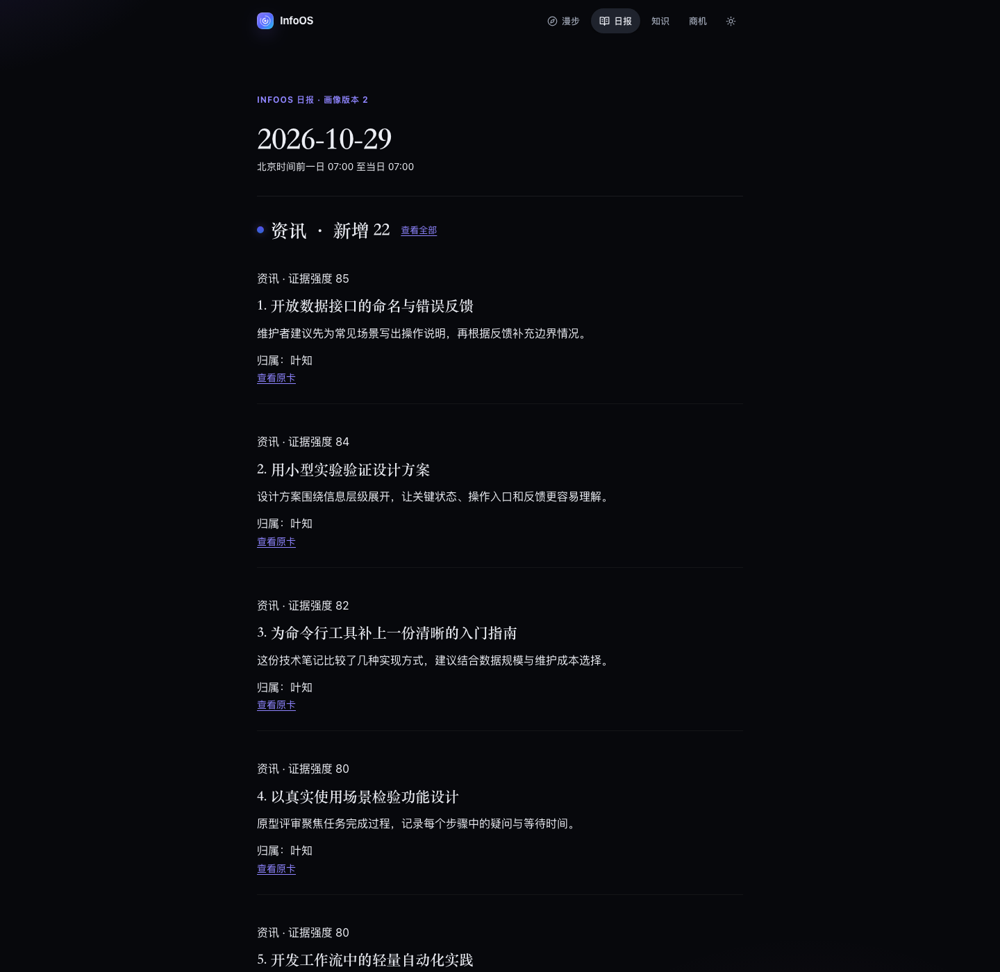

### 知识库：按类型查找已归库的内容

在 `/r/knowledge` 按项目、商机、方法、选题、资讯浏览知识卡，也可以选择子类型、搜索标题与字段。商机知识卡还支持按调研状态筛选，列表显示证据数量和更新时间。产品、资源两类当前尚未启用。

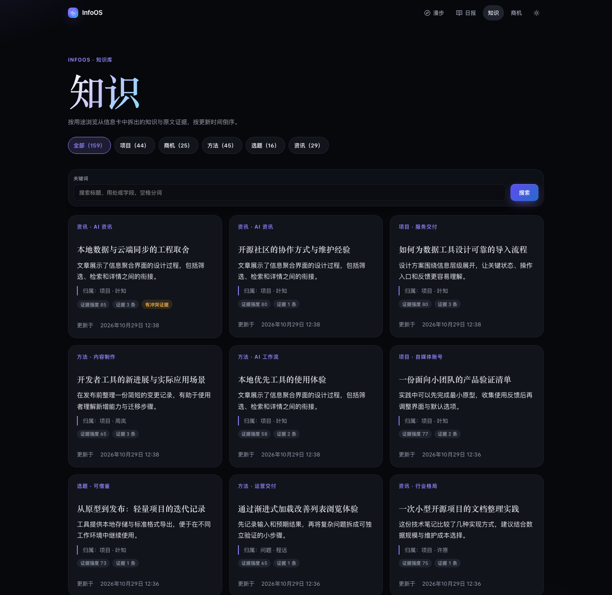

### 知识卡详情：结构化字段与原文证据放在一起

知识卡根据用途展示不同字段，例如方法卡包含问题、适用条件、步骤与效果证据。详情保留原信息卡链接、原文摘句、归并动作和冲突标记，也能查看同源知识卡；商机知识卡另有调研状态历史。

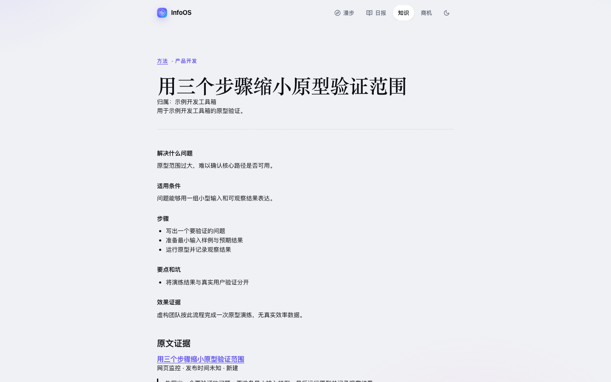

### 信息卡浏览：轻量阅读与筛选

「漫步」提供独立的阅读入口 `/r/browse`，可以按关键词、来源、平台、评估状态和时间筛选信息卡。列表展示原文片段与 agent 评估，点击后直接打开阅读弹窗，适合在信息之间逐条浏览。

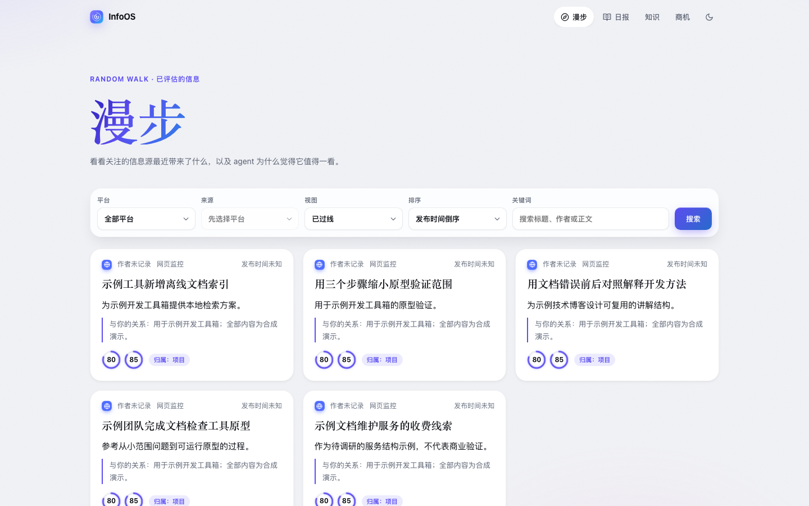

### 信息卡详情：回到原始材料核对

每张信息卡都有 `/r/card/{card_id}` 深链接，可阅读正文、内容块和已有附件，并查看处理状态、缺口与 agent 评估。知识卡引用的信息可沿链接回到这里核对，已有字幕、转录等内容也按内容块呈现。

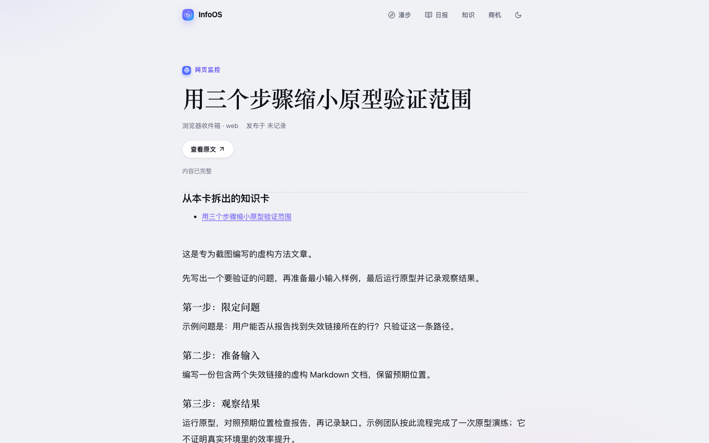

### 信息卡管理：从列表定位到处理详情

管理面的信息卡工作区将列表与详情并排展示，便于连续查看采集结果。可以搜索和筛选卡片，检查内容完整性、媒体附件和处理缺口，再打开独立阅读页。

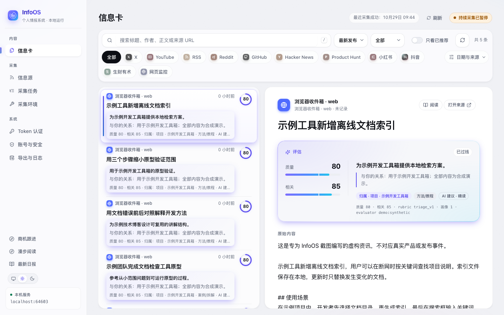

### 来源管理：维护持续采集的入口

来源面板支持新增、编辑、启停信息源，设置采集间隔和单次条数，并查看最近运行与状态。RSS、Hacker News、GitHub、Product Hunt 的公开能力和 YouTube 公开内容属于官方范围，具体来源类型以 [registry](backend/domain/sources/registry.py) 为准，YouTube 当前仍需浏览器会话。Reddit、知识星球、小红书、抖音、X，以及 YouTube 登录型用途 / home_feed 保持实验性标注，不保证登录型适配器可用；Web 捕获不属于可配置的定时来源。

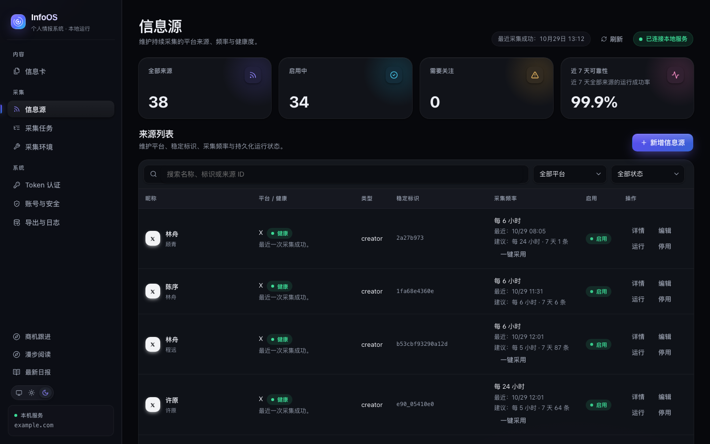

### 采集任务：查看来源运行与队列

任务页按来源运行展示采集状态、队列、等待时间和卡片处理进度，另有调研任务与全局任务队列入口。调研由交互式 agent 经 MCP 提交，网页用于查看过程和结果；采集入队、抓取成功与信息卡完成分别显示，便于识别卡在哪一步。

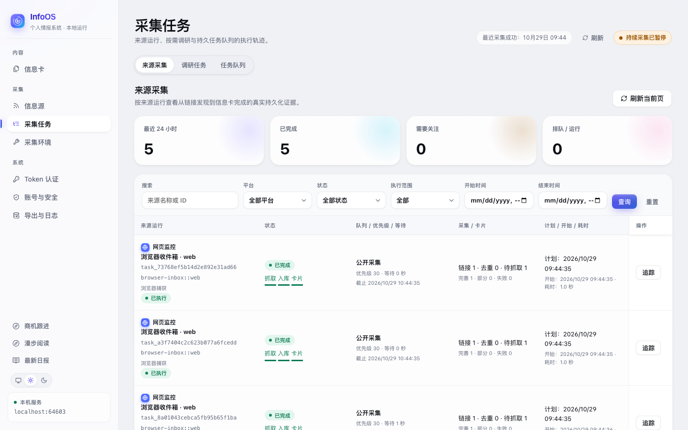

### 运行追踪：沿一条链路检查结果

打开一次来源运行的「追踪」，可以逐层查看抓取、入库和卡片处理的阶段证据、任务状态与错误原因。界面按任务状态提供重试或取消等操作，帮助定位问题，而无需从一段长日志猜测进度。

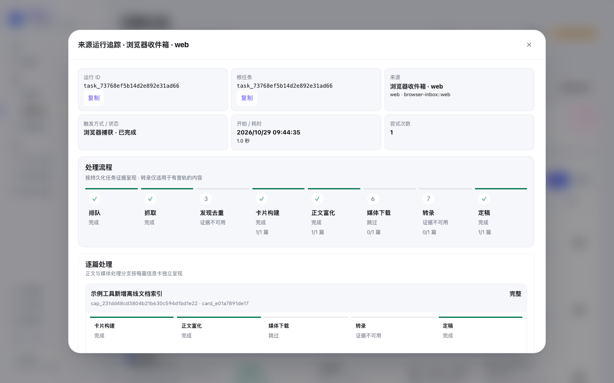

### 采集环境：检查浏览器会话和运行组件

环境页集中显示专用 Chrome、OpenCLI Bridge、媒体工具等组件状态，以及平台登录态、受影响来源和恢复提示。需要登录的平台由用户在专用浏览器中操作，再显式验证；也可以在这里查看通知与浏览器运行设置。页面状态不代表平台已通过采集验收。

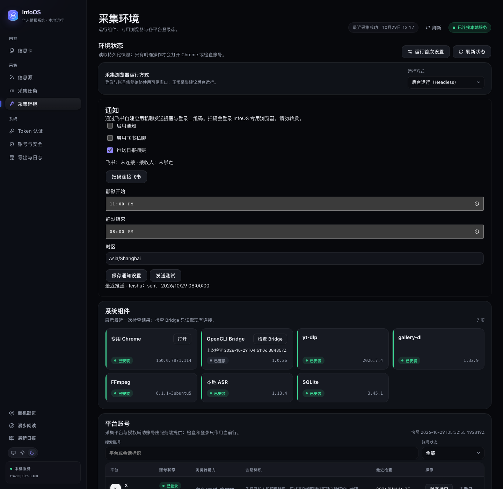

### 通知设置：接收提醒并设置静默时段

采集环境中的通知设置提供飞书连接、私聊提醒、日报摘要和静默时段选项。用户完成自己的应用连接与接收人绑定后，可以保存设置或发送测试。

通知与静默时段见上方采集环境截图。

### Token 权限管理：为不同客户端分配访问范围

可以为客户端或外部 agent 创建最小权限 Token，查看请求审计，并按需轮换、撤销或设置 Webhook。捕获 API 使用 `captures:write`，agent 捕获与调研使用 `collect:write`，评估和画像修改也有各自的 scope。

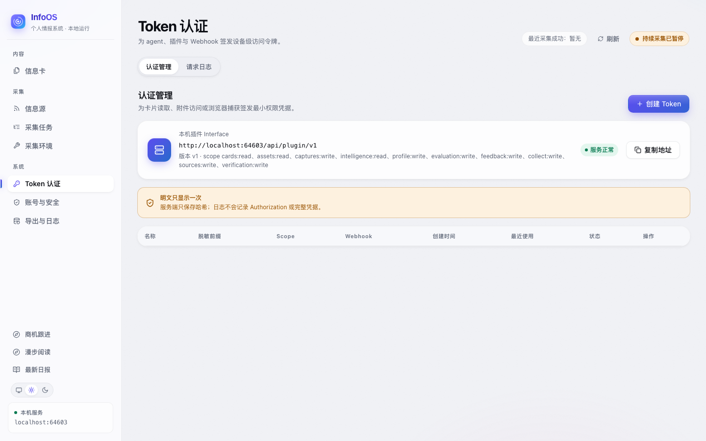

### 账号与安全：维护设备管理凭据

「账号与安全」提供管理员账户名与密码的修改表单，需要验证当前凭据。修改成功后，已登录设备需要重新登录。

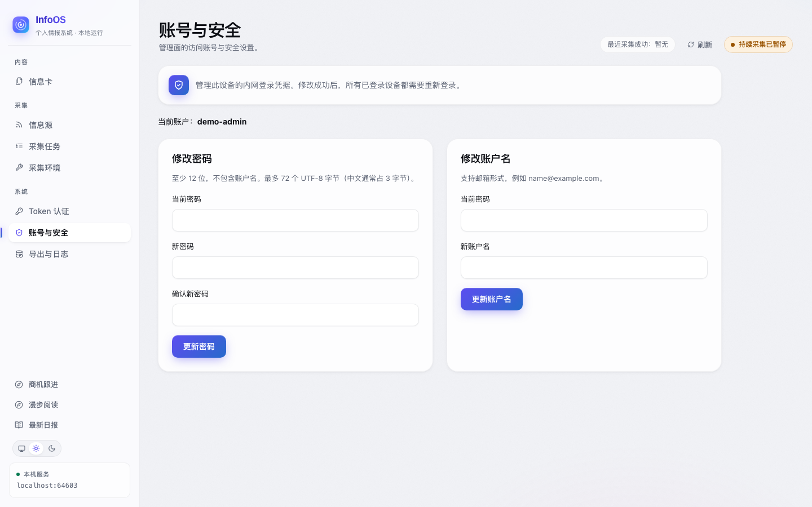

### 导出、备份与日志：把数据和诊断材料带走

支持异步生成 JSON 数据交换文件、SQLite 一致性快照备份与脱敏诊断包，内容和媒体附件可按导出类型选择。结构化日志支持筛选、分页、查看详情与复制，便于结合来源运行排查问题。

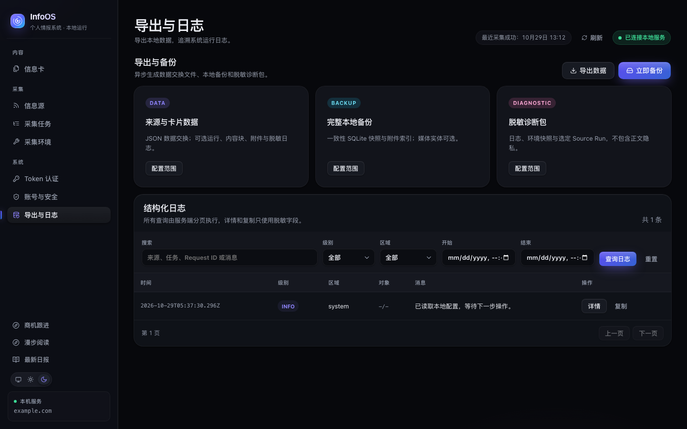

### 商机跟进：从线索到人工核实

`/r/opportunities` 保留基于信息卡商机拆解的跟进看板，可以筛选线索、决定跟进、归档或恢复自动阶段。已接触、转入行动由人工核实记录推导，实际接触与项目执行仍由用户在站外和 PKM 完成。它与知识库里的商机知识卡及其调研状态是两个入口。

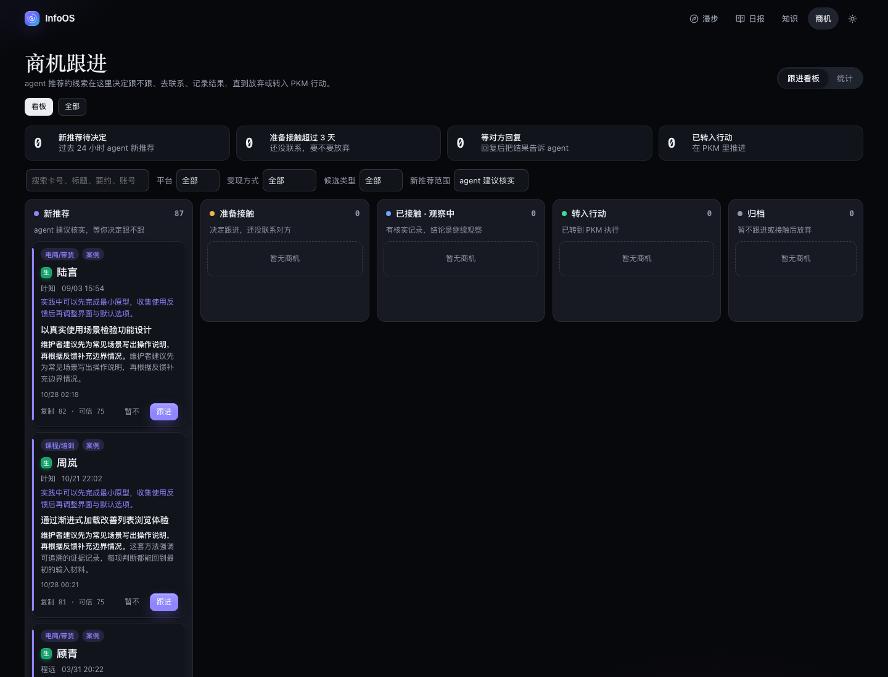

### 商机统计：查看线索与跟进事实

`/r/opportunities/stats` 按时间范围展示线索漏斗、平台分布、每日拆解和跟进转化。统计依据运行、卡片和核实记录计算，跨期积累可能使漏斗比例超过 100%。

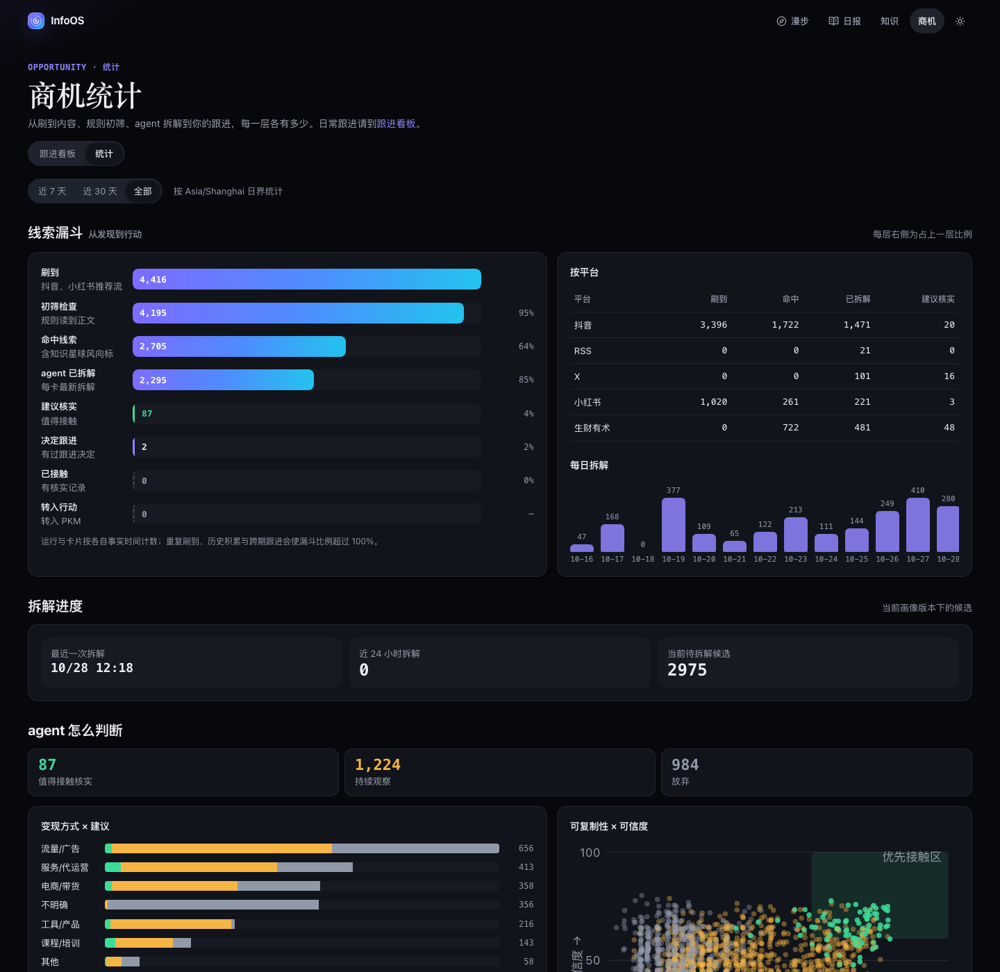

### 首次引导：连接采集环境并开始第一轮采集

首次设置引导用户打开专用 Chrome、连接 OpenCLI Bridge、处理平台登录并发起首次采集。无需当前使用的平台可以跳过，之后也可从采集环境重新进入设置；密码、验证码与平台授权由用户自行完成。

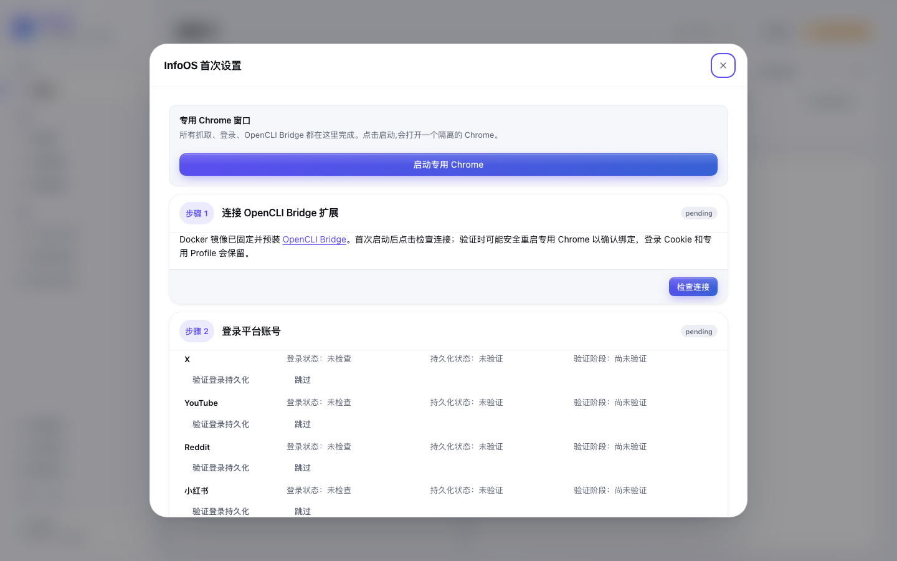

### 关注画像与 MCP：让外部 agent 按同一套标准整理

关注画像通过 MCP `push_profile/get_profile` 版本化读写，当前没有独立的网页画像编辑页。外部 agent 经 `/mcp` 读取信息卡、画像和标准，写回评估、拆解与归并结果；InfoOS 校验并保存结果，自身不调用 LLM。MCP 是协议接口，以下用实际工具调用顺序代替界面截图，具体权限见 [工具与权限表](docs/INSTALL-for-agents.md#5-mcp-工具与权限)。

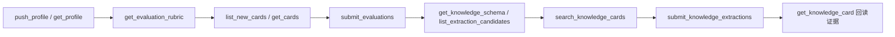

### 知识卡启动器：定时运行外部整理流程

仓库提供 [Codex CLI 启动器](deploy/agent/run-knowledge.sh) 和 [知识整理提示词](deploy/agent/knowledge-prompt.md)，可单次运行，也可安装 Linux systemd user timer 或 macOS launchd 定时任务。它在用户自己的 agent 环境中经 MCP 整理知识卡，提供运行锁、时间预算、日志与失败告警，账号和额度由用户自备。启动器没有产品网页，下面以流程图代替截图；定时任务安装不等于整理成功，仍需回读知识卡并核对日报。

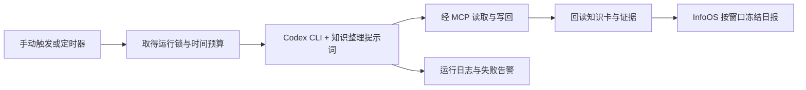

## 从零安装（候选安装草稿）

准备 Git、Docker Engine 和 Compose v2（GPU overlay 要求 2.30.0+），具备下载基础镜像、Chrome、npm/Python 包的网络条件。我们在 Linux amd64 上构建与验证，其他平台请使用者自行兼容。默认 Compose 配置为 6 GiB 内存 reservation、12 GiB 上限、14 GiB RAM+swap 上限和 1 GiB shared memory；这不是实测最低配置。镜像、浏览器、模型和附件需要额外磁盘空间，最低磁盘与完整从零安装的实测结果待安装验证补充。默认 CPU 路径无需 GPU；可选 CUDA 见 [部署手册](deploy/docker/README.md)。

在本仓库的干净、已审核版本中操作，首次安装使用独立配置目录与 Compose project。以下路径仅为用户自行选择的示例，不使用个人配置或种子数据库：

```bash
# 先把本仓库克隆到用户选择的目录并切到所需发布版本，再在源码根目录执行。
install -d -m 0700 "$HOME/.config/infoos-install"
cp deploy/docker/.env.example "$HOME/.config/infoos-install/appliance.env"
chmod 0600 "$HOME/.config/infoos-install/appliance.env"
```

用安全编辑器填写自己的 `INFOOS_ADMIN_USERNAME`、`INFOOS_ADMIN_PASSWORD`（建议强随机密码、至少 12 字符，且不超过 72 UTF-8 字节），保留 loopback 绑定；首次初始化校验非空、72 字节上限和无换行，12 字符下限由登录后的改密接口强制。模板留空，直接启动会失败，没有可用默认账号或密钥。Token 不写入模板。需要远程浏览器访问时先配置 [双因素网关](deploy/edge/README.md)，或经自有 SSH 隧道访问 loopback HTTPS；无网关时的最低要求见下文。

```bash
export INFOOS_SOURCE_COMMIT="$(git rev-parse --verify 'HEAD^{commit}')"
INFOOS_DOCKER_ENV_FILE="$HOME/.config/infoos-install/appliance.env" \
  deploy/docker/build-image.sh -p infoos-install

docker compose --env-file "$HOME/.config/infoos-install/appliance.env" \
  -p infoos-install -f deploy/docker/compose.yaml up -d

docker compose --env-file "$HOME/.config/infoos-install/appliance.env" \
  -p infoos-install -f deploy/docker/compose.yaml ps
```

默认从空的 `infoos-install-state`、`infoos-install-data` 卷启动，入口自动执行顺序迁移建库，不导入维护者数据。project 名改变时容器与卷名随之变化；不要设置指向已有实例的 `INFOOS_CONTAINER_NAME`、`INFOOS_STATE_VOLUME` 或 `INFOOS_DATA_VOLUME`。同机多实例还须选择不同宿主 HTTPS 端口、镜像标签和外部 agent 配置目录；后续命令始终用同一配置文件与 `-p`。Compose 即使只执行 `up` 或 `ps` 也需要解析构建参数，因此每个新 shell 都须设置上述完整 `INFOOS_SOURCE_COMMIT`；构建脚本内部的 export 不会保留到父 shell。`build-image.sh` 拒绝脏工作树并写入完整 HEAD revision；可通过显式 `INFOOS_CANONICAL_BRANCH` 限定构建分支，默认不绑定维护者分支。

访问 `https://127.0.0.1:8443`（或配置后的 HTTPS 地址），核对自签名证书来源后登录。进入「账号与安全」设置自己的凭据，初始化完成后从受保护环境中移除两个 `INFOOS_ADMIN_*` 值；已有用户库忽略初始化变量。不要删卷重置账户。升级、备份与恢复按 [部署手册](deploy/docker/README.md)，不运行 `down -v`。

## 从第一条信息读到日报

1. 在来源面板添加自己选择的真实 RSS feed，触发采集，在任务与信息卡中确认正文和 finalize 完成；HTTP 接收或任务入队不等于完成。样本应包含至少一种知识卡标准需要的实质信息。
2. 在 Token 面板创建自己的设备 Token。定时整理只给 `intelligence:read`、`evaluation:write`；首次设置关注画像时另用含 `profile:write` 的交互式 Token，经 MCP `push_profile` 写入用户自己的画像，再回读版本。不要给定时 Token 画像修改、来源修改或交互式核实权限。
3. 按 [外部 agent 手册](docs/engineering/opportunity-agent-runbook.md) 设置 HTTPS `/mcp` 地址和受保护的 Token 文件，使用 [知识整理提示词](deploy/agent/knowledge-prompt.md)。先交互式走通：`get_profile/get_evaluation_rubric/get_knowledge_schema` → `list_new_cards/get_cards/submit_evaluations` → `list_extraction_candidates/search_knowledge_cards/submit_knowledge_extractions` → `get_knowledge_card`。固定画像版本与窗口，核对 accepted/rejected，并回读字段和原卡证据；写回回执不代表归库与阅读验收。
4. 日报当前固定按 Asia/Shanghai 每日 07:00 截止的前 24 小时选知识卡，scheduler 在 07:00 后安排冻结。首次试用若已冻结空日报，可在登录的同源管理页面中调用 `POST /api/intelligence/daily-brief/YYYY-MM-DD/rebuild?force=true` 重建所选日期；这是管理会话接口，不能用 MCP Bearer 代替。所选日期窗口必须包含这次知识卡写入时间；例如上海时间当天 07:00 后写入的卡进入次日日报。核对返回 `layout=knowledge_v1`、非空条目与知识卡证据，再访问 `/r/brief/YYYY-MM-DD`。不要把空日报当作主链成功。
5. 手工链路通过后，再按手册安装 Linux systemd user timer 或 macOS launchd。agent 可在用户自己的另一台机器运行；Appliance 仍是数据真相。实际触发一次 timer 并回读结果，不能只看 unit 已安装。

MCP 与插件接口使用各自的最小 scope Bearer，不使用管理员密码。管理员、Token、外部 agent 登录和平台登录全部由用户设置；不提供共享服务或隐藏账户。

知识库入口为 `/r/knowledge`，知识卡详情为 `/r/knowledge/{knowledge_id}`，原信息卡为 `/r/card/{card_id}`。当前启用项目、商机、方法、选题、资讯五类，产品与资源尚未启用。日报按新鲜度和分栏上限选条，不是全部入库卡片的清单。

捕获 API `/api/capture/v1/` 使用 `captures:write`；agent 的 `capture_url/get_capture` 使用 `collect:write`。两者的 scope 不可互换，完整工具与权限表见 [agent 安装指南](docs/INSTALL-for-agents.md#5-mcp-工具与权限)。

## 网络与数据边界

[Compose](deploy/docker/compose.yaml) 只发布产品 HTTPS 端口，默认绑定 loopback。公网访问管理面、Browser Console、阅读与附件须用 [Authelia 双因素模板](deploy/edge/README.md)；网关覆盖客户端身份头，MCP 与插件不经双因素且保留各自 Bearer 认证。

不用双因素网关时，产品端口只绑定 loopback 或防火墙限制的可信局域网，使用 HTTPS、强管理员密码/表单会话和最小 scope Token，不得把管理面或 Console 直接暴露公网。CDP、VNC、OpenCLI daemon、debug 端口不发布；同源检查不能替代认证。浏览器使用专用非 root profile 和 sandbox，密码、MFA、Cookie 由用户自己输入。

默认构建不下载、不安装 mihomo，运行也默认不开内置代理。确需该代理时，构建设置 `INFOOS_WITH_MIHOMO=1`，再配置运行开关与受保护的代理源文件，详见 [受限网络出口](deploy/docker/README.md#容器内受限网络出口)。

## 实验性平台

Reddit 当前仍要求浏览器登录，免登录采集尚未交付；知识星球、小红书、抖音、X、YouTube 登录型用途及 home_feed 都是实验性能力，保留代码，不保证可用。Google 仅辅助浏览器会话，不是可配置来源。用户自行登录并遵守平台条款；官方分级不代表所有采集都已实现匿名路径，也不代表逐平台实机验收。

## 第三方组件与许可证

InfoOS 作者：**徐行AI**。项目采用 **AGPL-3.0-only**，全文见 [LICENSE](LICENSE)，原文来自 [GNU 官方文本](https://www.gnu.org/licenses/agpl-3.0.txt)。

构建下载或仓库附带的第三方组件、版本、来源与已知许可证见 [THIRD_PARTY.md](THIRD_PARTY.md) 和 [NOTICE](NOTICE)。未有许可证证据的项目标为「未确认」；本清单不作授权核查或组合授权结论。第三方组件保留各自归属与许可，用户须自行遵守，InfoOS 的许可证不替代这些许可。

## 开发与维护

个人项目，issue 尽力回复。当前安装说明仍是候选草稿；完整镜像构建、Appliance 部署真实链路和 Linux 开发机隔离安装尚待验证，未验证能力不作通过承诺。

- [文档索引](docs/README.md)、[产品合同](docs/product/infoos-intelligence-workbench-target.md)
- [工程结构](docs/engineering/project-structure-target.md)、[开发与测试](docs/engineering/local-env-playbook.md)
- [Docker 部署与恢复](deploy/docker/README.md)、[SQLite 迁移](docs/engineering/sqlite-migrations.md)
- [贡献前约束](AGENTS.md)

开发依赖安装：`make install`、`npm --prefix frontend install`。隔离测试使用 `~/.infoos-test` 或显式临时目录；不写默认或运行数据。公共源码、构建与检查均不依赖维护者私有仓库。
